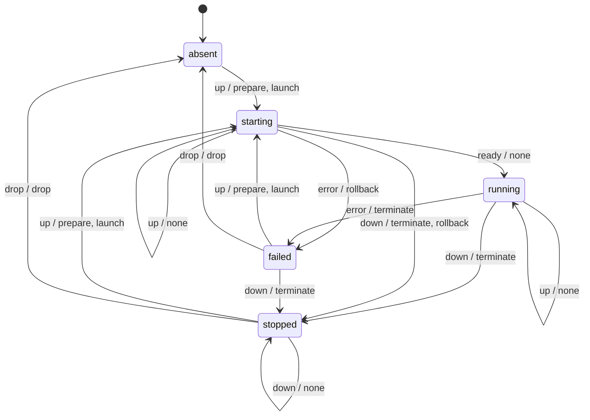

# Preview lifecycle

Generated by `python3 scripts/render_lifecycle.py`; checked by the unit suite.

| State | Event | Next | Effects |
|---|---|---|---|
| absent | up | starting | prepare, launch |
| absent | ready | invalid | none |
| absent | error | invalid | none |
| absent | down | invalid | none |
| absent | drop | invalid | none |
| starting | up | starting | none |
| starting | ready | running | none |
| starting | error | failed | rollback |
| starting | down | stopped | terminate, rollback |
| starting | drop | invalid | none |
| running | up | running | none |
| running | ready | invalid | none |
| running | error | failed | terminate |
| running | down | stopped | terminate |
| running | drop | invalid | none |
| failed | up | starting | prepare, launch |
| failed | ready | invalid | none |
| failed | error | invalid | none |
| failed | down | stopped | terminate |
| failed | drop | absent | drop |
| stopped | up | starting | prepare, launch |
| stopped | ready | invalid | none |
| stopped | error | invalid | none |
| stopped | down | stopped | none |
| stopped | drop | absent | drop |

## How states are recorded and observed

The launcher in the preview's tmux window applies these transitions and records each state in the
state file. `ls` corrects the recorded state with what exists:

| Recorded | Window and pane process alive | TCP listener | Reported |
|---|---|---|---|
| starting | yes | no | starting |
| running | yes | yes | running |
| running | yes | no | failed |
| starting | no | no | stopped |
| running | no | no | stopped |
| failed | no | no | failed |
| stopped | no | no | stopped |
